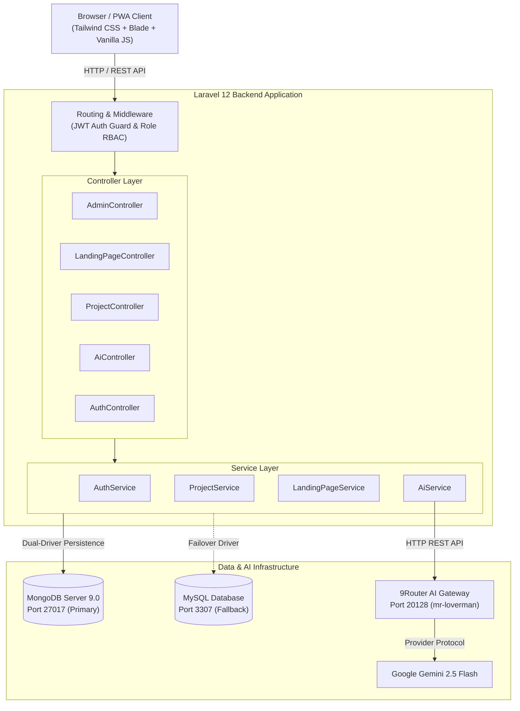

<div align="center">

# 🚀 NexaConsult

### AI-Powered UMKM Advisory, Strategic Roadmap Platform & Instant Landing Page Generator

[](https://laravel.com)
[](https://php.net)
[](https://mongodb.com)
[](https://tailwindcss.com)
[](https://ai.google.dev/)
[](https://jwt.io)
[](LICENSE)

<p align="center">
  Platform SaaS konsultasi bisnis digital cerdas untuk pelaku <b>UMKM Indonesia</b>. Dilengkapi asisten AI interaktif multi-turn, generator roadmap proyek otomatis, analisis SWOT & copywriting promosi instan, serta <b>AI Landing Page Studio (Lovable-Style)</b> dengan fitur zero-config auto-hosting publik.
</p>

[Fitur Utama](#-fitur-unggulan) • [Arsitektur Sistem](#-arsitektur-sistem) • [Instalasi & Menjalankan](#-panduan-instalasi--menjalankan) • [Kredensial Demo](#-kredensial-akun-demo) • [Dokumentasi API](#-dokumentasi-endpoint-api)

</div>

---

## 🌟 Fitur Unggulan

### 1. 🤖 Konsultasi Bisnis AI Interaktif (Multi-Turn Chatbot)
- Terhubung langsung dengan LLM berkecepatan tinggi via **9Router Local Gateway** (bertenaga Google Gemini 2.5 Flash).
- Analisis taktis, saran konten promosi viral (TikTok/Instagram), estimasi modal kerja, dan solusi operasional yang relevan dengan ekosistem bisnis Indonesia.
- **Deteksi Konfirmasi Cerdas**: Saat pengguna merespon persetujuan (*"ya"*, *"buatkan"*), AI langsung menawarkan pembuatan roadmap proyek terstruktur dalam 1 klik.

### 2. 📋 Manajemen Proyek & AI Suite Tools
- **Roadmap & Milestone Checklist**: Melacak progres tugas secara real-time dengan sinkronisasi persisten.
- ⚡ **AI Task Expander**: Secara otomatis memecah strategi usaha menjadi 5 milestone tugas operasional baru.
- 📊 **Analisis SWOT 4-Kuadran**: Membuka modal interaktif (*Strengths, Weaknesses, Opportunities, Threats*) lengkap dengan rekomendasi aksi taktis.
- 📢 **Marketing Pitch & Copywriting Suite**: Menghasilkan 4 format materi promosi siap pakai: *Elevator Pitch 30 Detik*, *Script Hook TikTok/Reels*, *Instagram Caption + Hashtags*, dan *Broadcast Promo WhatsApp* dengan tombol 1-klik salin (*copy to clipboard*).
- 🔄 **AI Strategy Regenerator**: Menulis ulang dan memodernisasi ringkasan strategi bisnis proyek.

### 3. 🌐 AI Landing Page Studio & Auto-Hosting (Lovable-Style)
- **Interactive Split-Screen Studio**: Editor visual dengan pratinjau multi-perangkat (*Desktop, Tablet, Mobile 375px*).
- **Desain Modern Otomatis**: Menghasilkan 1 file HTML mandiri berbasis Tailwind CSS responsif, lengkap dengan Hero CTA, Value Proposition, 3 Kartu Pricing dengan badge *"Paling Laris"*, Testimoni Bintang 5, Accordion FAQ, dan Tombol Melayang WhatsApp (*Floating Action Button*).
- **Instant Zero-Config Auto-Hosting**: Landing page yang dipublikasikan langsung tayang di rute publik `http://localhost:8000/site/{slug}` tanpa perlu setup web hosting eksternal. Rute ini dapat dibuka oleh siapa saja tanpa autentikasi, siap disematkan di bio media sosial.
- **1-Click Export**: Fitur salin link publik, buka langsung di tab baru, dan download file HTML mandiri.

### 4. 👑 Super Admin Control Center & Role-Based Access Control (RBAC)
- **Strict Role Separation**: Halaman admin (`/admin`) memiliki antarmuka backoffice tersendiri dengan 2 menu navigasi bersih: **Panel Kontrol** dan **Portal Pengguna ↗**.
- **In-Page Tab Switcher**: Navigasi modular yang rapi (*Semua Modul, Kelola Pengguna, Proyek UMKM, Landing Pages, dan Status Sistem*) tanpa perlu scrolling panjang.
- **System Health Monitor**: Pemantauan real-time status MongoDB 9.0 (Port 27017 Aktif) dan 9Router AI Gateway (Port 20128 Online).
- **User Management**: Mengubah peran pengguna (*Promote to Admin / Demote to User*) dan menghapus akun beserta data proyeknya.
- **Landing Page Monitoring**: Memantau dan mengelola seluruh landing page yang dibuat di sistem.

### 5. 🗄️ Dual-Driver Resilient Database (MongoDB + MySQL)
- Menggunakan **MongoDB Server 9.0** (`mongodb/mongodb: ^2.1`) sebagai basis data utama.
- Dilengkapi arsitektur *graceful fallback* ke **MySQL** jika layanan MongoDB tidak tersedia, memastikan keandalan sistem tetap 100% tanpa error 500.

---

## 🏛️ Arsitektur Sistem



---

## 🛠️ Tech Stack Matrix

| Komponen | Teknologi | Keterangan |
| :--- | :--- | :--- |
| **Backend Framework** | Laravel 12.x | PHP 8.3, MVC + Service Layer Architecture |
| **Basis Data Utama** | MongoDB 9.0 | MongoDB PHP Driver + `mongodb/mongodb: ^2.1` |
| **Basis Data Fallback** | MySQL / MariaDB | Eloquent ORM migrations & seeders |
| **Autentikasi** | JSON Web Token (JWT) | RFC 7519 HMAC-SHA256 Stateless Token |
| **AI Gateway Engine** | 9Router Gateway | Local OpenAI-compatible API proxy on port 20128 |
| **Model AI** | `mr-loverman` | Backend provider: Google Gemini 2.5 Flash |
| **Frontend Styling** | Tailwind CSS + Plus Jakarta Sans | Modern gradient glassmorphism, responsive mobile-first |
| **Notifikasi UI** | SweetAlert2 | Modal interaktif konfirmasi & feedback visual |

---

## 📋 Kredensial Akun Demo

| Peran Akun | Email | Password | Akses & Wewenang |
| :--- | :--- | :--- | :--- |
| **Super Administrator** | `admin@nexaconsult.id` | `AdminPassword2026!` | Panel Kontrol Admin (`/admin`), kelola pengguna, monitoring proyek & landing page |
| **Pemilik Usaha UMKM** | `user@nexaconsult.id` | `UserPassword2026!` | Portal UMKM (`/home`), konsultasi AI, manajemen proyek, AI Landing Page Studio |

---

## 🚀 Panduan Instalasi & Menjalankan

### 1. Kebutuhan Sistem
- **PHP** >= 8.2 (ekstensi `mongodb`, `pdo_mysql`, `curl`, `mbstring`, `openssl` aktif)
- **Composer** >= 2.0
- **MongoDB Server** (berjalan pada `localhost:27017`)
- **Node.js** >= 18 (untuk AI gateway 9router)

### 2. Kloning Repositori
```bash
git clone https://github.com/luminariadev/nexaconsult.git
cd nexaconsult
```

### 3. Pasang Dependensi PHP
```bash
composer install
```

### 4. Konfigurasi Lingkungan (`.env`)
Salin file template `.env.example` menjadi `.env`:
```bash
cp .env.example .env
php artisan key:generate
```
Pastikan pengaturan koneksi database dan AI telah sesuai di file `.env`:
```env
# MongoDB (Utama)
MONGODB_URI=mongodb://127.0.0.1:27017
MONGODB_DATABASE=nexaconsult

# AI Engine (9Router Local Gateway)
AI_PROVIDER=9router
AI_BASE_URL=http://127.0.0.1:20128/api/v1
AI_API_KEY=your_9router_api_key_here
AI_MODEL=mr-loverman
```

### 5. Jalankan Migrasi & Database Seeder
```bash
php artisan migrate --seed
```

### 6. Menjalankan Server Aplikasi
Jalankan development server Laravel:
```bash
php artisan serve --port=8000
```
Buka browser dan arahkan ke: **`http://127.0.0.1:8000`**

### 🐳 Menjalankan via Docker Compose
Jika lebih memilih menjalankan menggunakan Docker:
```bash
# Build dan jalankan seluruh container (App + MongoDB 7)
docker compose up -d --build

# Jalankan database seeder
docker compose exec app php artisan db:seed
```

---

## 📡 Dokumentasi Endpoint API

### 🔐 Autentikasi (`/api/auth`)
| Method | Endpoint | Auth | Deskripsi |
| :--- | :--- | :---: | :--- |
| `POST` | `/api/auth/register` | Publik | Mendaftarkan akun UMKM baru |
| `POST` | `/api/auth/login` | Publik | Otentikasi & menerbitkan token JWT |
| `GET` | `/api/auth/me` | JWT | Mengambil data profil pengguna yang sedang login |
| `POST` | `/api/auth/logout` | JWT | Menghapus sesi otentikasi |

### 🤖 Konsultasi AI (`/api/ai`)
| Method | Endpoint | Auth | Deskripsi |
| :--- | :--- | :---: | :--- |
| `POST` | `/api/ai/consult` | JWT | Konsultasi interaktif multi-turn UMKM via 9Router LLM |

### 📋 Manajemen Proyek (`/api/projects`)
| Method | Endpoint | Auth | Deskripsi |
| :--- | :--- | :---: | :--- |
| `GET` | `/api/projects` | JWT | Mengambil daftar seluruh proyek milik pengguna |
| `GET` | `/api/projects/{id}` | JWT | Mengambil detail proyek beserta milestone tugas |
| `DELETE` | `/api/projects/{id}` | JWT | Menghapus proyek dari database |
| `POST` | `/api/projects/{id}/tasks` | JWT | Menambahkan tugas baru ke roadmap |
| `PUT` | `/api/projects/{id}/tasks/{idx}/toggle` | JWT | Mengubah status selesai/belum selesai tugas |
| `POST` | `/api/projects/{id}/ai-expand` | JWT | AI menambahkan 5 milestone kerja strategis baru |
| `POST` | `/api/projects/{id}/ai-swot` | JWT | AI menganalisis SWOT 4 kuadran & rekomendasi aksi |
| `POST` | `/api/projects/{id}/ai-pitch` | JWT | AI menghasilkan materi copywriting TikTok, IG & WA |
| `POST` | `/api/projects/{id}/ai-regenerate` | JWT | AI memperbarui narasi ringkasan strategi bisnis |

### 🌐 Landing Page & Auto-Hosting (`/api/landing-page` & `/site`)
| Method | Endpoint | Auth | Deskripsi |
| :--- | :--- | :---: | :--- |
| `POST` | `/api/landing-page/generate` | JWT | AI meracik kode HTML landing page Tailwind responsif |
| `POST` | `/api/landing-page/save` | JWT | Menyimpan dan mengaktifkan auto-hosting landing page |
| `GET` | `/api/landing-page` | JWT | Mengambil daftar landing page milik pengguna |
| `GET` | `/site/{slug}` | **Publik** | **Halaman web landing page publik siap tayang (tanpa login)** |

### 👑 Panel Administrator (`/api/admin`)
| Method | Endpoint | Auth | Deskripsi |
| :--- | :--- | :---: | :--- |
| `GET` | `/api/admin/stats` | Admin | Statistik total pengguna, proyek, status DB & AI gateway |
| `GET` | `/api/admin/users` | Admin | Daftar seluruh pengguna terdaftar |
| `PUT` | `/api/admin/users/{id}/role` | Admin | Mengubah hak akses role (*admin / user*) |
| `DELETE` | `/api/admin/users/{id}` | Admin | Menghapus akun pengguna beserta seluruh datanya |
| `GET` | `/api/admin/projects` | Admin | Memantau seluruh proyek UMKM dari semua pengguna |
| `GET` | `/api/admin/landing-pages` | Admin | Memantau seluruh landing page yang ter-host |
| `DELETE` | `/api/admin/landing-pages/{id}` | Admin | Menghapus landing page dari sistem |

---

## 📄 Lisensi

Proyek ini didistribusikan di bawah lisensi resmi **MIT License**. Lihat file [LICENSE](LICENSE) untuk informasi lebih lanjut.

<div align="center">
  <sub>Built with ❤️ by <a href="https://github.com/luminariadev">luminariadev</a> for Indonesian UMKM Digital Transformation</sub>
</div>
